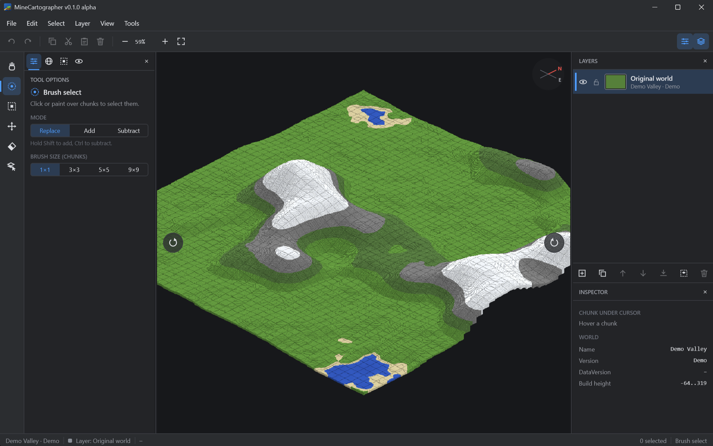

# MineCartographer

> **Early alpha, v0.1.0.** It works on the worlds it has been tested with, but expect bugs and
> rough edges, and things may change between versions. Back up your worlds and check an exported
> world in Minecraft before relying on it.

A desktop editor for combining Minecraft Java Edition worlds. Open several saves, possibly from
different game versions, copy chunks from one into another as layers, and export the result as a
new world. Your original saves are only read, never modified.



## Features

- **Reads Java Edition worlds from 1.2 to current versions**, including the old numeric block
  IDs (1.2–1.12), the palette formats (1.13–1.17) and the 1.18+ chunk layout.
- **Isometric 2.5D view** of the terrain. Pan with the mouse or WASD, zoom with the wheel,
  rotate in 90° steps.
- **Layers, like an image editor.** The original world is the bottom layer. Every paste becomes
  a new layer you can hide, lock, rename, reorder, merge down or flatten.
- **Selection tools:** brush, rectangle, select all/none/invert, layer to selection.
- **Tools** to move a layer, erase chunks and pick the layer under the cursor.
- **Copy and paste between worlds**, at the cursor or at the original coordinates.
- **Non-destructive edits** with full undo/redo. Erasing in the original world only hides
  chunks, and they can be restored.
- **Export** writes a new world folder. Untouched chunks are copied byte for byte.

## How merging different versions works

Every chunk in a Minecraft save records the game version it was written with, and Minecraft
upgrades old chunks one by one when it loads them. MineCartographer relies on this:

- The bottom layer (the original world) decides the version of the exported world.
- Pasted chunks keep their own version. When you open the exported world, Minecraft upgrades
  them, the same way it would upgrade an old world.
- Upgrading only works forwards, so chunks from a world **newer** than the base world can't be
  exported. Use the newest world as the base and paste older ones into it.

Moved chunks get their coordinates, block entities, entities and scheduled ticks updated. Their
lighting is recalculated by the game, and structure references (villages, strongholds and so on)
are removed from them so they don't point at the wrong place.

## Limitations

- Only the overworld is merged. The Nether, the End, player data and maps are copied from the
  base world.
- Erased chunks are left out of the export, so Minecraft generates new terrain there.
- Blocks from mods show in a neutral grey in worlds before 1.13.
- Worlds saved with LZ4 chunk compression (`region-file-compression=lz4` in newer servers)
  can't be read.
- Bedrock Edition is not supported.

**Keep a backup of anything you care about,** and test an exported world before you rely on it.

## Getting started

You need **JDK 25** to build and run from source. The Gradle wrapper is included.

```sh
./gradlew :app:run
```

You can also pass world folders to open at startup:

```sh
./gradlew :app:run --args="'C:/Users/you/AppData/Roaming/.minecraft/saves/My World'"
```

To build an installer for your platform (MSI on Windows, DMG on macOS, DEB on Linux):

```sh
./gradlew :app:packageDistributionForCurrentOS
```

The installer ends up in `app/build/compose/binaries/`.

## Using it

1. **File → Open world folder…** (Ctrl+O). Pick the world folder or its `level.dat`. The Worlds
   tab also lists saves found in the usual launcher folders.
2. Select chunks with the brush (B) or rectangle (R) tool and copy them (Ctrl+C).
3. Open the target world and paste (Ctrl+V). The chunks follow the cursor until you click, and
   become a new layer.
4. Arrange the layers, then **File → Export merged world…** (Ctrl+Shift+S).

### Keyboard shortcuts

| Keys | Action |
|---|---|
| WASD / arrows, right or middle drag | Move the view |
| Mouse wheel, `+` / `-` | Zoom |
| `,` / `.` | Rotate the view |
| F | Fit the world on screen |
| H, B, R, M, E, I | Move view, brush select, rectangle select, move layer, eraser, pick layer |
| Shift / Ctrl while selecting | Add to / subtract from the selection |
| Ctrl+A, Ctrl+Shift+A, Ctrl+I | Select all, none, invert |
| Ctrl+C / Ctrl+Shift+C | Copy from the active layer / copy everything visible |
| Ctrl+X, Del | Cut, clear from the active layer |
| Ctrl+V / Ctrl+Shift+V | Paste as a new layer / paste at the original coordinates |
| Ctrl+Shift+N, Ctrl+Shift+D | New layer, duplicate layer |
| PgUp / PgDn | Raise / lower the active layer |
| Ctrl+E, Ctrl+Shift+E | Merge down, flatten |
| Ctrl+Z, Ctrl+Y | Undo, redo |
| Ctrl+O, Ctrl+Shift+S | Open world, export |

## Project layout

```
core/   World formats and editing logic, no UI
  nbt/      NBT reader and writer
  anvil/    Region files, level.dat, surface extraction, export
  edit/     Layers, clipboard, undo history
app/    Compose Desktop editor
  viewport/ Isometric camera, chunk tile rendering and caching
  editor/   Editor state, tools, shortcuts
  ui/       Docks, panels, menus, dialogs
```

## Development

```sh
./gradlew build
```

Most tests run on their own. The tests that read and export real worlds need saves on disk:
set `MINECARTOGRAPHER_WORLDS` to a folder that contains Minecraft saves (it is searched a few levels
deep, so a launcher folder with several instances works). Those tests pick one world per game
version, only read them, and write exports to a temporary folder. Without the variable they
are skipped.

```sh
MINECARTOGRAPHER_WORLDS="$HOME/.minecraft/saves" ./gradlew :core:test
```

The app icon is drawn in code (`app/src/main/kotlin/minecartographer/ui/AppIcon.kt`). After changing
it, regenerate `app/icons/` and the startup splash with:

```sh
./gradlew :app:generateIcons
```

## Disclaimer

Not an official Minecraft product. Not approved by or associated with Mojang or Microsoft.
