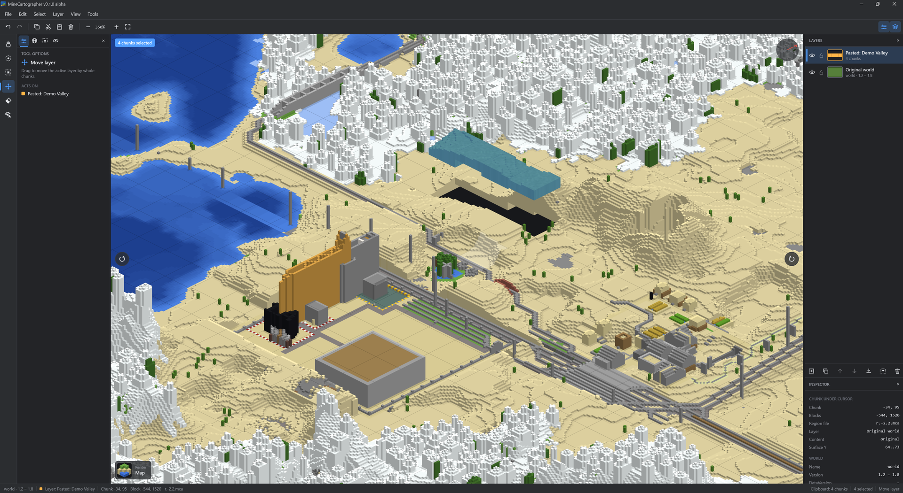
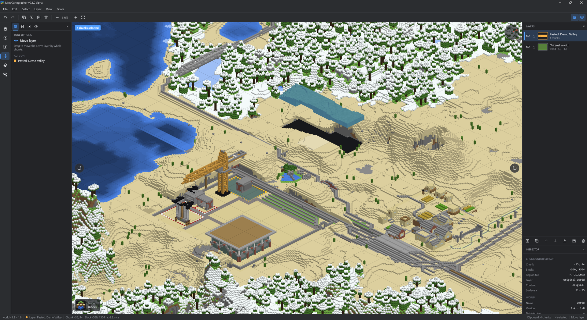
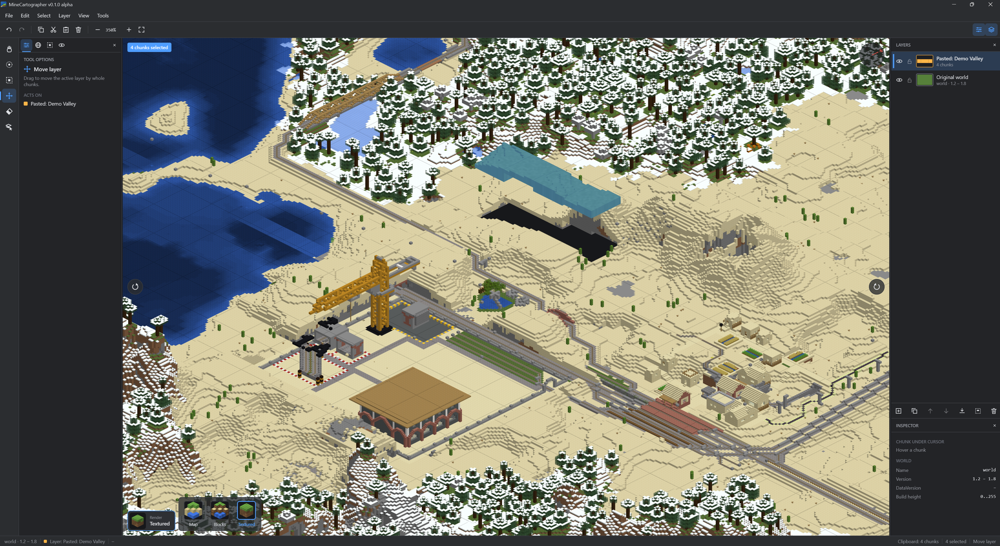
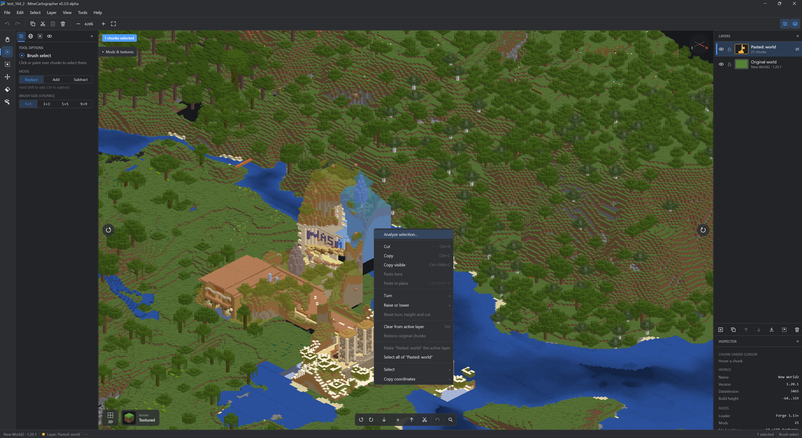
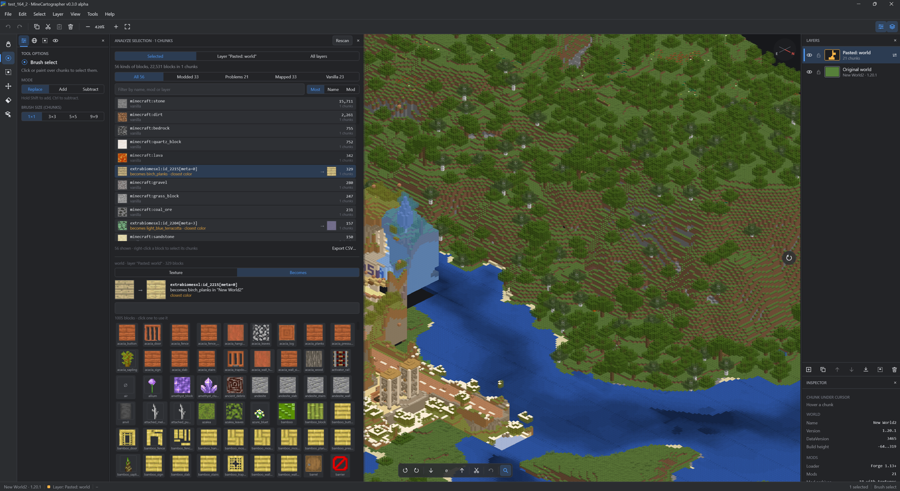
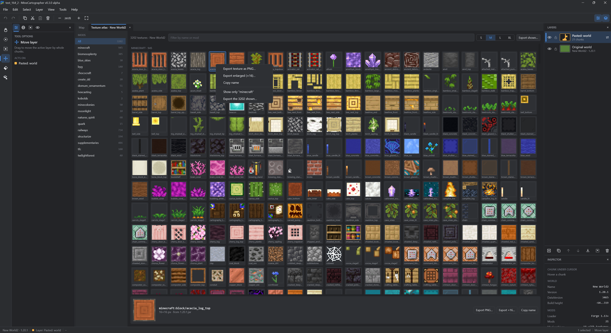

# MineCartographer

> **Early alpha, v0.3.** It works on the worlds it has been tested with, but expect bugs and
> rough edges, and things may change between versions. Back up your worlds and check an exported
> world in Minecraft before relying on it.

A desktop editor for combining Minecraft Java Edition worlds. Open several saves, possibly from
different game versions, copy chunks from one into another as layers, and export the result as a
new world. Your original saves are only read, never modified.


## Features

- **Reads Java Edition worlds from 1.2 to current versions**, including the old numeric block
  IDs (1.2–1.12), the palette formats (1.13–1.17) and the 1.18+ chunk layout.
- **Isometric 2.5D view** of the terrain. Pan with the mouse or WASD, zoom with the wheel,
  rotate in 90° steps.
- **Three render modes**, from fastest to most detailed: Map, Blocks and Textured (see below).
- **Layers, like an image editor.** The original world is the bottom layer. Every paste becomes
  a new layer you can hide, lock, rename, reorder, merge down or flatten.
- **Selection tools:** brush, rectangle, select all/none/invert, layer to selection.
- **Right-click menus** on the map, on a layer and on a block or texture: analyze, copy and paste,
  turn and raise, select, export.
- **Analyze a selection or a layer:** every block in it, how many, which are modded, and what each
  one becomes in the world it goes into.
- **Texture atlas:** every texture of your mods and packs on one page, with export to PNG.
- **Tools** to move a layer, erase chunks and pick the layer under the cursor.
- **Copy and paste between worlds**, at the cursor or at the original coordinates.
- **Non-destructive edits** with full undo/redo. Erasing in the original world only hides
  chunks, and they can be restored.
- **Projects** save the whole workspace (open worlds, layers, selection, camera and settings) to
  a small XML file you can open again later.
- **Export** writes a new world folder. Untouched chunks are copied byte for byte.

## Render modes

Switch modes with the button in the bottom-left corner of the view (hover it to see all three),
from **View** in the menu, or with the `1`, `2` and `3` keys.

**Map** draws only the top block of each column and extends it straight down to the ground, so
a tree or a tower becomes a solid pillar. It's the fastest mode, good for finding your way
around a large world.



**Blocks** draws every block you can see, in flat colors close to those on Minecraft's own maps,
but without textures. Shapes come out right: trees have leaves and trunks, and you can see overhangs
and the walls of buildings.



**Textured** uses Minecraft's own block models and textures, read from a client jar in the usual
launcher folders. Each world uses the jar of its own version when it's installed (1.13 and newer),
otherwise the newest one. In the View tab you can pick resource packs or a jar for each world, and
a default for the rest. Chunks pasted from another world keep the textures of the world they come
from. It's the slowest mode.



**2D or 3D.** The button next to the mode switcher (or `V`) flips between the isometric 3D view
and a classic map straight from above, north up. Every mode works in both: from above you see the
top of each column, shaded a little by its height against its neighbours. Selecting, pasting and
the other tools work the same.

## How merging different versions works

Every chunk in a Minecraft save records the game version it was written with, and Minecraft
upgrades old chunks one by one when it loads them. MineCartographer relies on this:

- The bottom layer (the original world) decides the version of the exported world.
- Pasted chunks keep their own version. When you open the exported world, Minecraft upgrades
  them, the same way it would upgrade an old world.
- Upgrading only works forwards, so chunks from a world **newer** than the base world can't be
  exported. Use the newest world as the base and paste older ones into it.

**Turning and height.** In the Selection tab, the chunks of a pasted layer (the selected ones, or the
whole layer) can be turned by quarter turns and raised or lowered block by block. Blocks turn with
them: stairs, doors, rails, fences, signs, item frames and so on keep facing the right way. Raised
chunks leave the original world below them, and **Cut at** keeps the original world below a height
too, so a pasted building can sit on the terrain without bringing its own underground. All of this
works across versions: a raised or cut chunk from an older world is converted to the base world's
version on the spot (blocks, biomes, chests and their items, signs, flower pots, heads, beds, banners,
entities), using the conversion tables of your newest installed Minecraft jar. Before 1.13 only vanilla
blocks turn their facing; modded ones move but keep theirs. The map shows the result exactly as it
will be exported.

**Modded blocks.** Blocks from mods the base world doesn't have (a 1.6.4 modpack pasted into vanilla
1.20.1, or a world of another modpack) are mapped to vanilla blocks: by their name (planks, logs, glass,
wool, ore...) and otherwise by the color of their texture; plants, pipes and cables become air. The
mapping button on the layer opens the list of what each block becomes, marks guesses by color, and lets
you pick another block. The choice is saved with the layer.

Moved chunks get their coordinates, block entities, entities and scheduled ticks updated. Their
lighting is recalculated by the game, and structure references (villages, strongholds and so on)
are removed from them so they don't point at the wrong place.

## Looking inside: right-click, analyze, textures

**Right-click** is the quickest way to the common actions. On the selection it offers analyze,
cut, copy, paste, turn, raise or lower, clear and restore. On any other chunk it can select it,
analyze it, paste here, make its layer the active one and copy its coordinates (chunk, block,
region file or a `/tp` command). A layer in the Layers panel has its own menu, and so do the blocks
in the analysis and the textures in the lists. Right-click an open world for **Info**: where it is on disk,
its game version and Forge version, the dates (last played, saved, created), game mode and seed, where the
player was, the dimensions and their size, the mods and where they were found, with buttons to open or copy
each path. Middle drag moves the view.



**Analyze.** Choose *Analyze selection…* (or *Analyze layer…* on a layer) to list every block in
those chunks, not only what shows from above: how many of each, in how many chunks, its texture,
and what it becomes in the base world, with a thumbnail of the result. Count the selected chunks as
the map shows them, only the active layer in them, or every layer. Filter by name, mod or layer,
sort by count, name or mod, pick a block's texture or what it becomes, right-click a block to select
the chunks that contain it, or export the list as CSV. The chunks are read when you ask; changing
the selection afterwards doesn't start a new count, it offers to analyze the new one.



**Texture atlas.** *View → Texture atlas* opens every block texture of the world's packs and mods
as a tab next to the map (the map tab stays, the atlas tab has a close button). Textures are grouped
by mod, with a filter and a size switch. Right-click a texture, in the atlas or in the texture picker
of *Mods & textures*, to save it as a PNG (as the pack has it, or enlarged with sharp pixels), copy
its name, or export everything shown into a folder laid out like a resource pack.



## Limitations

- Only the overworld is merged. The Nether, the End, player data and maps are copied from the
  base world.
- Erased chunks are left out of the export, so Minecraft generates new terrain there.
- Blocks from mods show in a neutral grey in worlds before 1.13.
- Worlds saved with LZ4 chunk compression (`region-file-compression=lz4` in newer servers)
  can't be read.
- Bedrock Edition is not supported.

**Keep a backup of anything you care about,** and test an exported world before you rely on it.

## Getting started

You need **JDK 25** to build and run from source. The Gradle wrapper is included.

```sh
./gradlew :app:run
```

You can also pass world folders, or a `.mcproj` project file, to open at startup:

```sh
./gradlew :app:run --args="'C:/Users/you/AppData/Roaming/.minecraft/saves/My World'"
```

To build an installer for your platform (MSI on Windows, DMG on macOS, DEB on Linux):

```sh
./gradlew :app:packageDistributionForCurrentOS
```

The installer ends up in `app/build/compose/binaries/`.

## Using it

1. **File → Open world folder…** (Ctrl+O). Pick the world folder or its `level.dat`. The app
   never searches your computer for saves on its own.
2. Select chunks with the brush (B) or rectangle (R) tool and copy them (Ctrl+C).
3. Open the target world and paste (Ctrl+V). The chunks follow the cursor until you click, and
   become a new layer.
4. Arrange the layers, then **File → Export merged world…** (Ctrl+Shift+S).

### Projects

**File → Save project** (Ctrl+S) stores the current workspace in a `.mcproj` file: which worlds
are open, every layer with its chunks, each world's textures, the selection, the camera, the render
mode and the dock layout. **File → Open project…** (Ctrl+Shift+O) brings all of it back, and
**File → Recent projects** lists the last ones.

For each world the project also remembers the client jar its textures came from (the "core"
textures), even when they were found automatically, so the world looks the same the next time.
An export writes `minecartographer-sources.xml` into the new world folder. It lists every world
that chunks came from, how many, and their textures, so you can later see which textures and
resource packs the merged world needs. Minecraft ignores the file. The title bar shows `*` when there are unsaved changes, and the editor asks
before closing them.

A project only refers to worlds by their folder and never contains them, so it stays small. The
path is stored relative to the project file as well as in full, so you can move a project together
with its saves. If a world can't be found, the project opens without it and tells you which
chunks were left out. Undo history and the clipboard are not saved.

The file is plain XML, so you can read it or keep it in version control:

```xml
<minecartographer-project format="1" app-version="0.3.1-alpha">
  <worlds active="w0">
    <world id="w0" name="My World" kind="folder" path="saves/My World" absolute-path="C:\...\My World"/>
    <world id="w1" name="Old World" kind="folder" path="saves/Old World" absolute-path="C:\...\Old World">
      <textures>
        <file path="resourcepacks/Exotic.zip" absolute-path="C:\...\Exotic.zip"/>
        <core-jar absolute-path="C:\...ersions.16.5.16.5.jar"/>
      </textures>
    </world>
  </worlds>
  <stack world="w0" active="1" next-id="2">
    <base visible="true" locked="false">
      <erase x="4" z="-2"/>
    </base>
    <layer id="1" name="Pasted: Old World" visible="true" locked="false" color="#FFFFB547">
      <chunk x="10" z="3" world="w1" from-x="0" from-z="0"/>
    </layer>
  </stack>
  <stack world="w1" active="0" next-id="1">
    <base visible="true" locked="false"/>
  </stack>
  <editor render-mode="Blocks" rotation="0" zoom="2.0" .../>
</minecartographer-project>
```

### Keyboard shortcuts

| Keys | Action |
|---|---|
| WASD / arrows, middle drag | Move the view |
| Right click | Menu for the selection, a chunk or a layer |
| Mouse wheel, `+` / `-` | Zoom |
| `,` / `.` | Rotate the view |
| F | Fit the world on screen |
| 1, 2, 3 | Map, Blocks, Textured render mode |
| V | 2D view from above / 3D view |
| H, B, R, M, E, I | Move view, brush select, rectangle select, move layer, eraser, pick layer |
| Shift / Ctrl while selecting | Add to / subtract from the selection |
| Ctrl+A, Ctrl+Shift+A, Ctrl+I | Select all, none, invert |
| Ctrl+C / Ctrl+Shift+C | Copy from the active layer / copy everything visible |
| Ctrl+X, Del | Cut, clear from the active layer |
| Ctrl+V / Ctrl+Shift+V | Paste as a new layer / paste at the original coordinates |
| Ctrl+Shift+N, Ctrl+Shift+D | New layer, duplicate layer |
| PgUp / PgDn | Raise / lower the active layer |
| Ctrl+E, Ctrl+Shift+E | Merge down, flatten |
| Ctrl+Z, Ctrl+Y | Undo, redo |
| Ctrl+N, Ctrl+Shift+O | New project, open project |
| Ctrl+S, Ctrl+Alt+S | Save project, save project as |
| Ctrl+O, Ctrl+Shift+S | Open world, export |

## Project layout

```
core/   World formats and editing logic, no UI
  nbt/      NBT reader and writer
  anvil/    Region files, level.dat, surface extraction, export
  edit/     Layers, clipboard, undo history
  project/  Project files (XML)
app/    Compose Desktop editor
  viewport/ Isometric camera, chunk tile rendering and caching
  editor/   Editor state, tools, shortcuts
  ui/       Docks, panels, menus, dialogs
```

## Development

```sh
./gradlew build
```

Most tests run on their own. The tests that read and export real worlds need saves on disk:
set `MINECARTOGRAPHER_WORLDS` to a folder that contains Minecraft saves (it is searched a few levels
deep, so a launcher folder with several instances works). Those tests pick one world per game
version, only read them, and write exports to a temporary folder. Without the variable they
are skipped.

```sh
MINECARTOGRAPHER_WORLDS="$HOME/.minecraft/saves" ./gradlew :core:test
```

The app icon is drawn in code (`app/src/main/kotlin/minecartographer/ui/AppIcon.kt`). After changing
it, regenerate `app/icons/` and the startup splash with:

```sh
./gradlew :app:generateIcons
```

## Disclaimer

Not an official Minecraft product. Not approved by or associated with Mojang or Microsoft.
